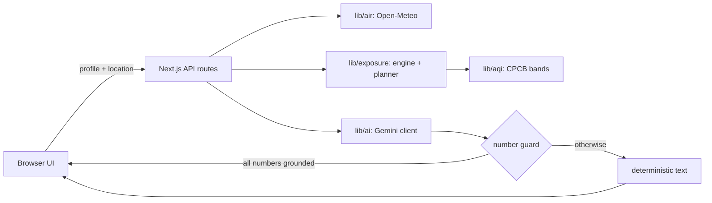

# Architecture

Aeris keeps one rule: **code decides, AI explains.** Every number comes from deterministic code.
Gemini only turns free text into a profile, narrates a finished plan, and answers questions about
it, and a guard rejects any number it was not given.

## Layers

| Layer         | Path                                         | Responsibility                                                   |
| ------------- | -------------------------------------------- | ---------------------------------------------------------------- |
| UI            | `components/`, `app/`                        | Presentational components, accessibility, language switch        |
| Client state  | `lib/client/`, `lib/useLocalStorageState.ts` | Fetch wrappers, validated local storage                          |
| API plumbing  | `lib/api/handler.ts`                         | Rate limit, size limit, JSON + zod validation, error mapping     |
| Domain        | `lib/exposure/`, `lib/aqi/`                  | Pure functions: exposure model, actions, ranked plan, CPCB AQI   |
| Data          | `lib/air/`                                   | Open-Meteo geocoding and air quality, cached with a TTL          |
| AI            | `lib/ai/`                                    | Prompts, structured output, number guard, deterministic fallback |
| Cross-cutting | `lib/env.ts`, `lib/log.ts`, `lib/http.ts`    | Validated env, safe logging, upstream errors                     |

## Decisions

1. **Pure domain core.** Actions are transformations of exposure inputs, so a benefit is
   `before - after` and overlapping actions cannot double count.
2. **No database.** Profiles stay in the browser's local storage; the server is stateless.
3. **Fallbacks everywhere.** If Gemini is missing, slow, or returns an ungrounded number, the user
   still gets a correct plan with deterministic wording.
4. **Validation at the edge.** One handler (`postHandler`) owns rate limiting, body size and schema
   validation for every route, so routes contain only business logic.
